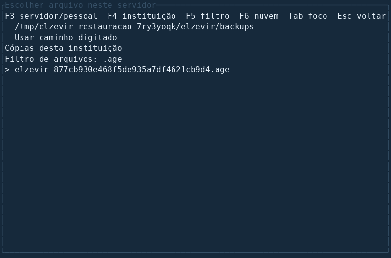
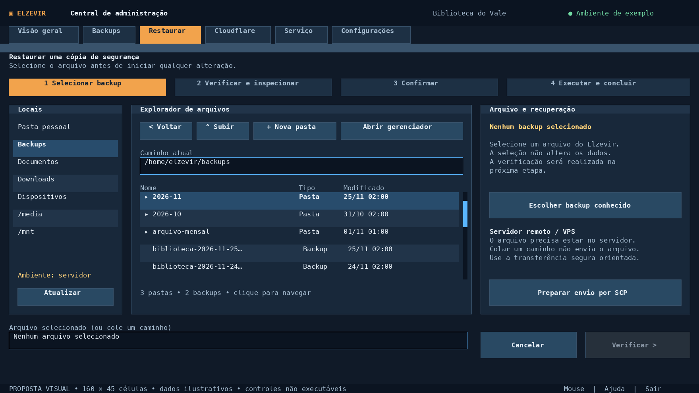
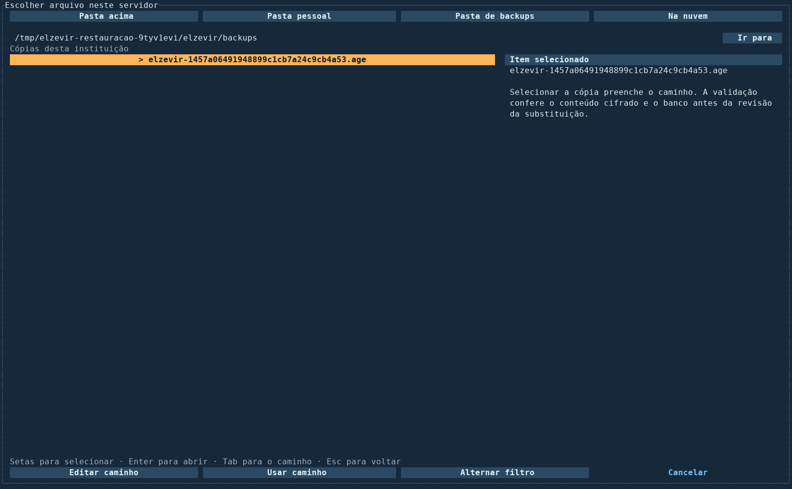
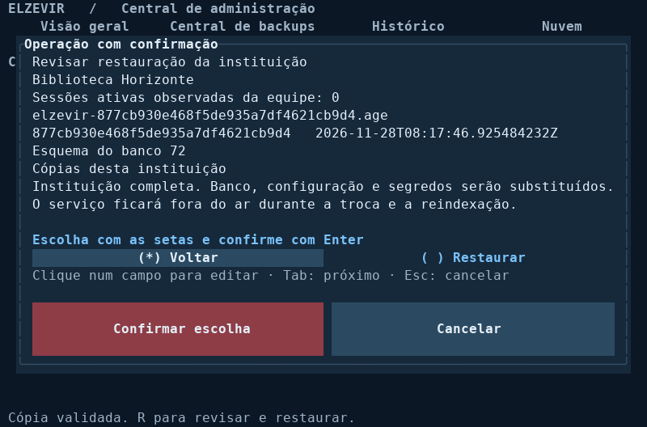
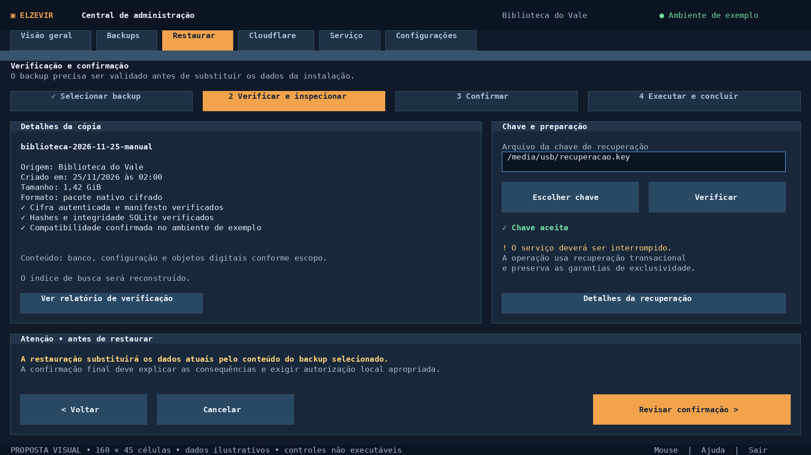
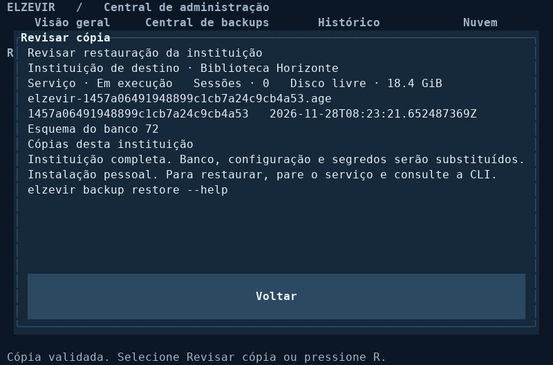

# Marco D — restauração

O Marco C entrou na main pelo [PR #300](https://github.com/PauloFBaldiFH/Elzevir/pull/300). A base desta comparação é `c799bd96` e o código do Marco D está em `1b6c6d9d`. O estudo comparativo identificou dois obstáculos na recuperação de uma cópia. Era preciso descobrir a tecla F2 para escolher arquivos. Na instalação pessoal, a revisão também oferecia uma substituição que o auxiliar só executa em instalações gerenciadas. [Estudo e prioridades](../../evolucao-painel-operacional.md) · [Contrato da restauração no painel](../../specs/operacao/painel-operacoes.md)

## Comparação visual

As imagens centrais são as propostas 08 e 09 do pacote do autor. As imagens das colunas externas vieram de execuções do binário em terminal. Cada imagem pode ser aberta no tamanho original.

| Percurso | Antes | Proposta | Marco D |
| --- | --- | --- | --- |
| Seleção do arquivo |  |  |  |
| Revisão em instalação pessoal |  |  |  |

O seletor dá acesso à pasta pessoal, à pasta de backups e aos arquivos em nuvem. Em 160×45 a lista e os detalhes ficam lado a lado. Em 80×24 a lista ganha a largura do terminal. O percurso de revisão conserva em tela o destino, a data da cópia, o esquema, o escopo e o impacto sobre banco e configuração. O disco livre e a contagem de sessões são observações do momento da consulta. O preparo e as verificações de segurança continuam no executor.

| Estado da operação | Captura real |
| --- | --- |
| Antes da primeira validação | [Área de restauração](restauracao-inicial.png) |
| Escolha da cópia e da chave no host do painel | [Cópias da instituição](escolher-arquivo-80x24.png) · [Arquivos para seleção da chave](seletor-chave.png) |
| Caminhos preenchidos antes da autenticação | [Validar cópia](validar-arquivo-chave.png) |
| Revisão disponível após autenticação | [Retorno à central](copia-validada-80x24.png) · [Revisão pessoal em tela larga](revisao-pessoal.png) |
| Chave divergente após uma validação anterior | [Falha de validação e revisão indisponível](chave-divergente.png) |

## O que o ensaio comprovou

- O roteiro inicializou uma biblioteca temporária e criou uma cópia cifrada nativa pelo servidor em loopback. A TUI permitiu escolher arquivo e chave com cliques, validar, voltar e reabrir a revisão. O cancelamento preservou o serviço. A validação com outra identidade de teste invalidou a revisão anterior. Uma segunda conexão confirmou a resposta administrativa do servidor.
- Na instalação pessoal, a revisão indica a restauração pela CLI com o serviço parado. O roteiro parou exclusivamente a instituição descartável, alterou seu nome na configuração e executou a restauração real da cópia com confirmação explícita. O nome original retornou e o servidor reiniciado respondeu à consulta da política pelo canal administrativo.
- A instalação gerenciada mantém a decisão inicial **Voltar**. A aplicação exige a escolha explícita de **Restaurar** e confirmação. O auxiliar existente verifica novamente a assinatura do manifesto, serializa a operação, controla o serviço e consulta sua saúde. Os testes de transição cobrem falha antes da troca, recuperação da instalação anterior e recuperação pendente. O histórico da TUI mostra o estado do recibo do host. Os testes de armazenamento cobrem exclusão concorrente, diário e falha de reindexação.
- O resultado de um download concluído pode abrir a validação do arquivo local correspondente ao plano. O teste de interação cobre a troca do destino. O download continua usando o contrato de nuvem do Marco C.

A suíte completa passou com 1.375 testes executados e nenhum ignorado. Os roteiros em terminal dos Marcos A, B, C e D passaram no binário desta branch. No roteiro C, o envio em nuvem produziu o recibo esperado de falha no ambiente sem rclone gerenciado e a CLI verificou a cópia local retida. Formatação, Clippy, xtask e cargo-deny passaram.

## Reprodução

Debian GNU/Linux 13, Elzevir 0.1.0-alpha.2, terminal de teste xterm-256color em português brasileiro. O roteiro usa PTY, eventos SGR de pressionar e soltar o mouse, pyte, Pillow e fontes DejaVu. Os diretórios temporários são exclusivos de cada execução. A geração da comparação anterior usa o binário da base com `--baseline`.

```sh
cargo build --locked -p elzevir --bin elzevir
python3 tools/panel/capture_restore.py --output /tmp/elzevir-capturas-d
cargo fmt --all --check
cargo clippy --workspace --all-targets --locked -- -D warnings
cargo xtask ci
cargo nextest run --workspace --locked --run-ignored all --no-fail-fast --test-threads 4
cargo deny check
```

## Limites e decisões para revisão

A substituição pessoal e o retorno do serviço foram observados nesta execução. A substituição gerenciada por systemd ou SCM precisa de homologação em uma instalação de ensaio registrada. Também ficam pendentes o cliente SSH em outro computador, Windows nativo, WSL e as tarefas com operadores da biblioteca.

Para oferecer a substituição pessoal inteiramente pela TUI, a proposta é definir como o auxiliar identifica a instituição, aguarda a parada, publica o recibo durável e permite retomar após falha. Para oferecer uma função de **restauração de ensaio**, a proposta é um destino privado com identidade isolada, orçamento de disco, agendas e conectores externos inativos e descarte comprovado. Essas duas ampliações requerem revisão de contrato. O próximo marco do roteiro é Cloudflare, após a revisão visual e funcional de D.
