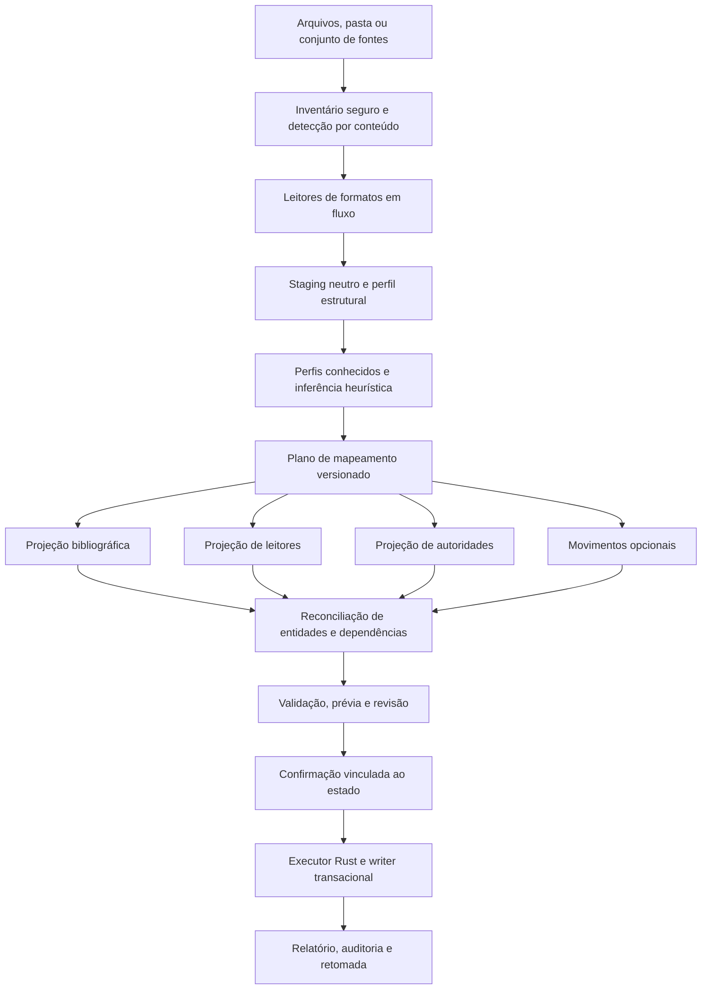

# Elzevir — Prompt mestre para evolução da Ferramenta Mágica de Importação

**Revisão 2 — generalização, investigação arquitetural e corpus ampliado.**  
**Natureza:** mandato de engenharia, especificação de escopo ampliado e roteiro incremental de implementação, precedido de investigação técnica obrigatória.  
**Objetivo:** transformar o importador atual em um motor universal de migração bibliotecária, capaz de reconhecer fontes conhecidas e desconhecidas, interpretar seus dados com evidências e importar com integridade para o Elzevir.  
**Escopo:** acervo bibliográfico (incluindo exemplares), leitores/usuários e autoridades, de forma independente ou combinada em uma mesma fonte. Preservar e concluir o suporte a circulação previsto no plano anterior, como extensão dependente dessas entidades.  
**Idioma:** documentação de planejamento em português; código, comentários e identificadores segundo as convenções vigentes do repositório; interface internacionalizada por Fluent.

---

## 1. Mandato ao agente de engenharia

Atue como engenheiro sênior de sistemas Rust, arquiteto de dados, especialista em migração de sistemas integrados de bibliotecas e catalogação MARC/BIBFRAME. Conduza o trabalho com rigor biblioteconômico, segurança, eficiência e atenção à experiência do bibliotecário.

O Elzevir não deve terminar com apenas mais uma coleção de importadores específicos. O objetivo é construir uma **infraestrutura comum de reconhecimento, interpretação, preparação, reconciliação, validação e execução de migrações**, em que novas fontes conhecidas sejam acrescentadas sem duplicar o motor, e fontes ainda desconhecidas possam ser analisadas por heurísticas explicáveis.

**Meta central de generalização:** reconhecer a natureza dos dados, não necessariamente o software que os produziu. Uma base de um SIGB desconhecido, mas com estruturas e semânticas bibliotecárias interpretáveis, deve poder ser migrada mediante mapeamento verificável, sem exigir que um programador escreva um novo importador Rust para cada produto. Perfis conhecidos são aceleradores e evidências adicionais, não pré-requisitos para a importação. O objetivo não é maximizar a lista de marcas reconhecidas, mas ampliar a classe de problemas que o motor consegue resolver com segurança.

A experiência pretendida é simples: o bibliotecário entrega um arquivo, pasta ou conjunto de arquivos; a ferramenta identifica o conteúdo, separa os tipos de dados encontrados, propõe os mapeamentos, explica as incertezas, mostra o impacto e permite confirmar uma importação segura. A sofisticação deve ficar no motor, não na quantidade de telas ou decisões desnecessárias.

**Princípios inegociáveis:**

- Não inventar dados bibliográficos, autoridades, leitores, exemplares ou relações para preencher lacunas.
- Não descartar informação relevante silenciosamente; distinguir preservação bruta, interpretação semântica, transformação deliberada e informação não representável no destino.
- Não confundir reconhecimento do formato com compreensão da semântica, nem compreensão parcial com suporte completo.
- Não prometer importar qualquer backup proprietário, criptografado ou sem especificação. Quando necessário, reconhecer, diagnosticar e indicar precisamente o que falta para decodificá-lo.
- Não reescrever o importador a partir do zero. Reaproveitar o trabalho existente e evoluí-lo incrementalmente.
- Não transferir decisões de integridade, autorização ou escrita para IA. Heurísticas e IA propõem; validações determinísticas e comandos de domínio decidem o que pode ser gravado.
- Não sacrificar o núcleo BIBFRAME por conveniência de uma origem. MARC, SQL, tabelas locais e formatos proprietários pertencem às bordas.
- Não encerrar com um estudo puramente conceitual. O resultado pretendido é código funcional, testes reproduzíveis, documentação atualizada e critérios de aceite por etapa. Se uma etapa depender de evidência externa ainda indisponível, entregar o que for seguro, registrar o bloqueio e prosseguir com etapas independentes.

## 2. Ponto de partida: preservar o que já foi conquistado

O planejamento anterior foi construído sobre o diagnóstico nas revisões `4e2cae80` / `e0d3981b` e as amostras da revisão `11536f7`, originalmente em `PauloFBaldiFH-patch-13`. O relato de execução informa:

- PR #228, integrado à `main` em `9b330865`, com matching seguro, identidade de origem, prévia de alcance e revalidação transacional; preservação de títulos, exemplares, notas locais, codificação e identificadores externos. A implementação inicial foi relatada em `0ab79ba2`, com fixtures em `46ecf286`.
- Perfil Biblivre 949 na branch `feat/biblivre-exemplares-949`, commit `6db9eba0`: 10 registros, 18 exemplares vinculados corretamente, reimportação sem duplicação e recuperação dos bytes originais. O relato registra 1.041 testes aprovados e o teste de rclone aprovado separadamente. **Verificar se essa branch/PR já está integrada à main antes de trabalhar.** Não assumir integração apenas porque o desenvolvimento foi concluído.
- O plano anterior excluía expressamente a carga de autoridades. **Essa restrição de escopo está revogada para esta evolução.** Autoridades passam a ser uma frente obrigatória, com o mesmo nível de importância de acervo e leitores. Atualizar as especificações afetadas, sem apagar a história das decisões anteriores.

Esses dados são um histórico fornecido pelo mantenedor, não uma auditoria da árvore atual. A `main` efetivamente disponível no início do trabalho prevalece sobre números de linhas, caminhos e estados de branches antigos.

### 2.1. Inspeção inicial obrigatória

Antes de implementar:

1. Identificar branch, commit, estado da árvore de trabalho, PRs relevantes e situação da integração do perfil Biblivre. Preservar alterações locais do mantenedor; não executar reset destrutivo.
2. Ler integralmente `CLAUDE.md`, as fontes de verdade de arquitetura (`docs/arquitetura/04-decisoes.md`, `05-definicoes-de-implementacao.md` e ADRs aplicáveis), `docs/ARCHITECTURE_VISION.md`, a especificação BIBFRAME completa e as specs de catalogação, autoridade, leitores, circulação, importação e interface que existirem na revisão atual.
3. Localizar o importador, suas portas, modelos, persistência, migrações, CLI, rotas Staff, templates, testes, limites de segurança e infraestrutura de benchmark. Identificar o que já está concluído, parcial, ausente ou incompatível com o novo escopo.
4. Inspecionar integralmente o inventário de `samples-import-tool/` (nome confirmado no histórico; verificar a localização real). Não limitar a busca às nove amostras originais: novas bases serão depositadas nessa pasta, possivelmente em subdiretórios. Não processar indiscriminadamente arquivos de quarentena como `_fora_do_escopo/` ou diretórios de código.
5. Verificar e documentar a situação do módulo de autoridades. Se já existir, integrar pelos contratos e comandos existentes. Se estiver incompleto, propor/implementar os pré-requisitos de domínio e persistência necessários, em etapa própria, respeitando a ontologia e as regras vigentes. Não criar um cadastro paralelo de autoridades exclusivo do importador.
6. Executar as verificações de baseline exigidas pelo projeto e registrar resultados reais, inclusive falhas preexistentes e testes ignorados. Não mascarar falhas nem reduzir a qualidade da suíte para obter verde.

Entregar um mapa de lacunas e uma matriz de rastreabilidade requisito → módulo → teste → amostra, antes de alterar comportamento. Atualizar specs primeiro, testes que falham depois e só então implementação.

### 2.2. Investigação profunda obrigatória antes de escolher a solução (Fase 0A)

**Não começar a implementar imediatamente após ler este prompt.** O mantenedor quer aproveitar a capacidade de análise e criatividade do agente de engenharia, não apenas sua capacidade de executar uma lista de tarefas. Este documento é um mandato de objetivos e garantias, não uma prescrição imutável de algoritmo. O agente deve estudar a arquitetura real, o histórico e todo o corpus elegível, confrontar o planejamento com evidências e procurar ativamente uma solução superior antes de consolidar o desenho. Não assumir que o agente que escreveu este prompt já encontrou a melhor arquitetura possível.

A investigação deve ser abrangente, prática e predominantemente em leitura, sem alterar o comportamento do produto, executar dumps não confiáveis ou enviar dados privados a terceiros. Ferramentas locais de inspeção, consultas seguras sobre staging descartável e protótipos isolados com fixtures permitidas são admitidos. Eles não constituem mudanças no runtime nem compromissos antecipados com uma arquitetura. Não confundir a IA de desenvolvimento, que conduz esta investigação, com a IA opcional integrada ao Elzevir em produção.

**Roteiro de descoberta:**

1. Cumprir integralmente a inspeção da seção 2.1. Rastrear o fluxo real de ponta a ponta: leitura, detecção, interpretação, matching, projeção BIBFRAME, persistência, busca e UI. Verificar contratos de entidades, garantias de segurança, decisões históricas e pontos reutilizáveis. Documentar os caminhos com referências a arquivos, símbolos e testes reais.
2. Inventariar recursivamente todas as fontes entregues, inclusive arquivos compactados, mantendo origem e conjuntos independentes. Inspecionar todas as estruturas relevantes, não apenas exemplos convenientes. Para arquivos grandes, percorrer em fluxo, produzir estatísticas, examinar amostras representativas e casos de fronteira; não despejar milhões de linhas no contexto do modelo. Registrar o que foi integralmente verificado, o que foi amostrado, o que não foi decodificado e por quê.
3. Construir uma anatomia comparativa das bases: como cada origem representa obras/edições, itens, holdings, leitores, autoridades, variantes, vínculos, chaves, vocabulários, circulação e campos locais. Identificar equivalências estruturais, diferenças reais de semântica, entidades ausentes, redundâncias e falsos amigos. Verificar relações por DDL, cobertura de chaves, conteúdo e documentação autorizada; nomes são apenas pistas. Separar esquemas, seeds, fixtures independentes, dados populados e artefatos auxiliares.
4. Extrair padrões transversais e contraexemplos. Perguntar o que há de comum entre um SQL relacional, um pacote de TSV com UUIDs, MARC com exemplares embutidos, uma planilha sem cabeçalho e um legado com IDs opacos. Distinguir problemas de decodificação dos de reconstrução semântica. Identificar o que pode ser resolvido por primitivas genéricas e o que genuinamente exige um adaptador ou intervenção humana.
5. Investigar, sem obrigação de adotar, técnicas de integração de esquemas, descoberta de dependências de inclusão, data profiling, entity resolution, matching com restrições, inferência de grafos, alinhamento de ontologias, ETL declarativo e mecanismos de feedback humano. Usar fontes técnicas confiáveis quando a pesquisa externa estiver autorizada e disponível; citar referências e distinguir literatura, hipóteses e resultados medidos. Não adicionar dependências por modismo.
6. Comparar alternativas arquiteturais plausíveis e a evolução mínima do código atual. Considerar, por exemplo, pipeline tabular/estruturado comum; representação intermediária como grafo de entidades e evidências sobre staging relacional; inferência por candidatos e restrições globais; perfis declarativos compilados em operações tipadas; uma composição híbrida dessas ideias. Esses exemplos não são exigência de implementar um grafo separado, um solver ou um framework novo. Comparar precisão, capacidade de generalização, abstenção, custo, memória, complexidade, manutenção, explicabilidade, segurança e compatibilidade com Rust, SQLite WAL e BIBFRAME. Descartar alternativas inferiores com justificativa.
7. Procurar uma ideia melhor que o plano inicial: uma representação mais econômica, descoberta de relações mais robusta, composição de receitas, redução de perguntas ao bibliotecário, reaproveitamento de código ou uma técnica que reduza o risco de overfitting. Testar as hipóteses promissoras em pequenos experimentos reproduzíveis e contraexemplos, quando viável. Não inventar novidade para parecer criativo; uma solução simples demonstravelmente melhor é preferível.
8. Revisar criticamente a própria proposta: onde ela produziria falsos vínculos? O que aconteceria se todos os nomes de tabelas fossem traduzidos, se os IDs coincidissem por acaso, se uma tabela misturasse funcionários e leitores, se faltassem autoridades ou se duas exportações fossem independentes? Onde o algoritmo deve se abster? Como manter o mesmo executor para todas as origens? Simular cenários difíceis antes de comprometer o desenho.

**Entregável de decisão antes de implementação:** produzir estudo técnico versionável (no local apropriado conforme as convenções reais do repositório), contendo inventário e matriz comparativa do corpus, diagnóstico do código e baseline, oportunidades de melhoria, hipóteses/experimentos com resultados reais, alternativas e trade-offs, desenho recomendado com fronteiras e invariantes, política de avaliação independente, riscos e lacunas, decisões e justificativas, e roteiro revisado por PR. Incluir o que foi mantido, aprimorado ou rejeitado em relação a este prompt. Distinguir achados de hipóteses ainda não testadas. Preservar rastreabilidade requisito → módulo → teste → amostra.

**Liberdade com responsabilidade:** se a investigação revelar arquitetura ou algoritmo melhor, o agente deve propor e, dentro da autorização vigente, incorporar a melhoria às specs/ADRs antes de implementar. Este prompt não autoriza violar garantias de segurança, fidelidade biblioteconômica, três classes independentes, runtime Rust, BIBFRAME ou arquitetura vigente; mudanças em invariantes, escopo, dependências estratégicas ou decisões que exijam aprovação devem ser submetidas ao mantenedor. Não bloquear toda a execução por uma dúvida independente. Não pedir aprovação a cada escolha reversível de engenharia; respeitar checkpoints explícitos. Uma vez concluído o estudo, prosseguir conforme a autorização de execução já concedida, sem ficar indefinidamente em planejamento.

**Critério de saída da Fase 0A:** estudo fundamentado concluído, baseline registrada, opções comparadas, proposta escolhida e justificada, plano atualizado e avaliação holdout definida antes de otimizar o algoritmo. Nenhuma implementação de comportamento de produção antes dessa conclusão. Se faltar uma fonte, permissão ou evidência, registrar a lacuna e delimitar o que pode ser concluído com o corpus disponível; nunca afirmar que o conteúdo indisponível foi estudado.

## 3. Contrato funcional ampliado: três conjuntos de dados de primeira classe

A ferramenta deve tratar as três classes como módulos de importação com seleção independente, mas integrados pelo mesmo motor, identidade de origem e plano de migração.

| Conjunto | Entidades abrangidas | Resultado esperado |
|---|---|---|
| Bibliográfico | Obras, Instâncias, Itens, holdings, relações, títulos, contribuições, assuntos, identificadores, material, séries e classificações, conforme o modelo vigente | Acervo semanticamente correto, pesquisável e com exemplares reais devidamente vinculados |
| Usuários | Leitores, identificadores de origem e carteirinhas, dados cadastrais permitidos, contatos, vínculos de unidade/categoria, datas, restrições e relações pertinentes | Leitores utilizáveis pelas regras do Elzevir, sem importação automática de credenciais nem concessão de privilégios |
| Autoridades | Registros de autoridade e vocabulários compatíveis: pessoas, organizações, eventos, lugares, conceitos/assuntos, títulos/obras controlados e demais classes efetivamente representadas no modelo; formas preferidas, variantes, identificadores, relações e procedência | Autoridades de primeira classe, pesquisáveis, reconciliáveis e vinculáveis ao acervo por função e evidência |

Não equiparar a existência de uma string de autor ou assunto à existência de um registro de autoridade. Não equiparar operadores de um sistema legado a leitores. Não confundir uma edição com um exemplar físico. O modelo de destino e as evidências da origem devem governar essas distinções.

### 3.1. Modos de entrada e operação

Implementar e testar:

- **Bibliográfico independente:** importar um MARC, planilha, dump parcial ou outro conjunto bibliográfico sem exigir uma base de leitores ou autoridades.
- **Usuários independente:** importar cadastro de leitores sem exigir acervo ou autoridades.
- **Autoridades independente:** importar uma base de autoridades sem exigir acervo ou leitores. Permitir vinculação posterior a ocorrências bibliográficas existentes mediante reconciliação segura e prévia.
- **Dump misto/completo:** aceitar uma única fonte contendo quaisquer combinações das três classes. Detectar todas, inclusive quando o arquivo não anuncia o tipo no nome. Permitir selecionar uma, duas ou três; a ausência de um conjunto não é erro.
- **Conjunto de fontes complementares:** aceitar pasta, arquivo compactado com múltiplos membros ou vários arquivos enviados numa sessão (ex.: bibliográfico MARC + holdings + autoridades MARC + leitores CSV; ou tabelas SQL/TSV separadas). O usuário confirma se as fontes pertencem à mesma instalação ou a origens distintas. Não juntar IDs de instituições diferentes por coincidência numérica.
- **Importação em momentos diferentes:** autoridades primeiro ou depois do acervo; leitores separados; complemento posterior de exemplares e relações. Identidade de origem deve permitir reencontro sem duplicação.
- **Reimportação e atualização:** diferenciar criar, vincular a objeto existente, atualizar campos selecionados, preservar existente, ignorar e deixar pendente. Substituição exige alcance claro, confirmação e revalidação.

Circulação não substitui nenhuma das três classes. É um conjunto operacional adicional, preservado do escopo anterior: detectar empréstimos ativos e históricos, reservas e outros movimentos existentes; importar apenas os tipos cujo comportamento e integridade estejam comprovados e tenham suporte de domínio. Oferecer seleção independente quando as dependências puderem ser resolvidas com entidades já existentes. Não forçar migração de históricos pessoais apenas porque estão no dump. Aquisições, finanças, configurações, permissões e demais subsistemas não entram automaticamente no escopo por aparecerem em um backup; inventariar, classificar e declarar o destino de cada grupo.

## 4. Arquitetura: um motor, múltiplas origens, três projeções



### 4.1. Responsabilidades e fronteiras

| Camada | Responsabilidade | Proibição |
|---|---|---|
| Leitura e detecção | Assinaturas, compressões, sintaxe, inventário e decodificação | Decidir que um campo é um exemplar apenas pelo nome |
| Staging | Representar registros, tabelas, campos, tipos, valores e relações de origem, com procedência | Gravar no catálogo de produção ou conceder acesso |
| Perfil/heurística | Identificar sistema, versão, papéis de conjuntos, mapeamentos e alternativas | Substituir objeto ou inventar relacionamento |
| Projeção semântica | Converter para comandos/DTOs tipados aceitos pelo domínio | Introduzir etiquetas MARC ou códigos locais específicos no núcleo BIBFRAME |
| Reconciliação | Candidatos, identidade externa, conflitos, dependências e alcance | Escolher o primeiro candidato ou fundir homônimos |
| Prévia e execução | Validar, apresentar, confirmar, gravar e reconciliar contagens | Executar dump SQL arbitrário ou ignorar conflitos |
| Staff/CLI | Orquestração e interação, usando o mesmo serviço e receita | Implementar regras de negócio distintas ou acesso direto ao banco |

Reaproveitar `elzevir-app`, `elzevir-domain`, `elzevir-marc`, `elzevir-store`, `elzevir-web`, `elzevir-web-templates` e o executável conforme as fronteiras existentes. Usar as portas de aplicação e adaptadores do store. Novas crates somente se trouxerem separação comprovadamente necessária, com justificativa e teste de camadas. Runtime integralmente Rust; não exigir Python, Java, um servidor MySQL/PostgreSQL ou ferramentas externas para o caminho normal de importação. Qualquer utilitário externo de desenvolvimento utilizado para produzir fixtures não passa a ser dependência do produto.

### 4.2. Representação intermediária, receitas e extensão

Definir ou ampliar contratos internos tipados (os nomes abaixo são conceituais, não uma obrigação de substituir abstrações existentes):

- `SourceDescriptor`: identidade estável da instalação/base, origem declarada e inferida, versão, formato, fingerprint de esquema e digest do arquivo/conjunto.
- `SourceInventory`: membros, tabelas, planilhas, tipos de registro, quantidade observada, compressão, encoding, limites, anomalias e classes de dados encontradas.
- `SourceRecordRef`: origem, arquivo/membro, tabela/aba, chave/posição, ocorrência e referência ao conteúdo bruto permitido.
- `SourceSchemaProfile`: colunas e tipos declarados/observados, chaves, relacionamentos, cardinalidades, nulos, padrões e sinais bibliotecários.
- `MappingRecipe`: versão, compatibilidade estrutural, seleção de fontes/entidades, campos de origem e destino, transformações, agrupamentos, junções, resolução de vocabulário, precedência, visibilidade, política de nulos, decisões aprovadas e evidências.
- `MigrationPlan`: receita congelada, dependências, contagens, decisões de matching, alterações propostas, versões do destino, pendências e impactos.
- `MigrationOutcome`: resultados por entidade/unidade, erros tipados, procedência, IDs de destino, progresso e dados necessários para retomada e auditoria.

Manter staging genérico na borda/aplicação; não criar um segundo catálogo semântico concorrente ao BIBFRAME. Usar representação de valores capaz de distinguir ausente, nulo, vazio, texto, número, bytes e datas com interpretação ainda pendente. Preservar o valor lexical original de identificadores, inclusive zeros à esquerda. Evitar carregar toda a base em objetos na RAM.

A receita deve ser declarativa, serializável, validada, versionada e reproduzível sem IA. Estender o executor de receitas JSON/TOML existente quando possível. Não admitir SQL arbitrário, scripts fornecidos pelo usuário, loops sem limite ou acesso a rede/disco fora do contexto controlado. Definir operadores tipados para selecionar, renomear, normalizar, converter datas, dividir/concatenar, consultar dicionário, agrupar, juntar por chaves demonstradas, mapear vocabulário e estabelecer relações. Toda operação deve indicar origem, destino e possibilidade de perda.

## 5. Detecção por conteúdo e leitores de formato

Separar rigorosamente **contêiner → formato de transporte → dialeto/estrutura → perfil de sistema → classes de entidade**. A extensão é pista fraca, não evidência conclusiva. Exemplos: `.backup` pode conter SQL textual ou PGDMP; `.bkp` pode ser binário proprietário; `.sql` pode ser relatório com MARCXML incorporado; `.mrc` pode trazer bibliográficos, autoridades ou ambos.

| Família | Requisitos mínimos |
|---|---|
| Compressão e arquivos | Gzip, ZIP, Zstandard, zlib onde aplicável; tar/tar.gz se presente nas amostras; inventário de membros, leitura em fluxo, limites cumulativos de expansão e profundidade, detecção de truncamento e corrupção |
| MARC | ISO 2709, MARCXML, MRK/Mnemonic, MARC21 bibliográfico, holdings e autoridades; UNIMARC bibliográfico e autoridade com perfil próprio; identificar tipo por registro, validação estrutural, charset declarado/detectado |
| Tabular | CSV, TSV, TXT delimitado, planilhas XLSX; avaliar XLS/ODS/DBF quando encontrados; aspas, multilinhas, delimitadores, BOM, cabeçalhos ausentes/duplicados, células mescladas, datas, tipos e valores de exibição |
| Estruturado | JSON/JSONL, XML, TSV com campos estruturados, exportações e manifestos FOLIO; validar estrutura e preservar hierarquia; RDF/BIBFRAME quando houver suporte de entrada real, sem confundir RDF genérico com catálogo válido |
| SQL textual | MySQL/MariaDB (INSERT simples/múltiplo, listas de colunas, escapes, DDL), PostgreSQL (COPY FROM stdin textual e INSERT, escapes e nulos), SQLite (DDL/INSERT e dialeto); outros dialetos mediante evidência e testes |
| Bancos/backup | SQLite binário em modo somente leitura e isolado; PostgreSQL custom PGDMP quando leitor/decodificador comprovado; nunca tratar um arquivo PGDMP como SQL comum. Reconhecer outros backups e indicar conversão segura quando não houver suporte nativo validado |
| Legados | ISIS/CISIS (MST/XRF e arquivos de definição/exportação necessários, conforme versão), Biblioteca Fácil (.dat/.idx e contêiner), outros binários encontrados; decodificar por especificação, versão e amostra de referência. Reconhecimento sem decodificação deve ser status explícito |

Para SQLite binário, não abrir como banco operacional, não carregar extensões nem executar triggers ou expressões arbitrárias da origem; definir modo read-only, restrições de esquema/consulta e limites conforme a biblioteca usada. Para SQL, utilizar lexer/parser e extrair dados, nunca restaurar/executar o dump no banco do Elzevir. Interpretar apenas gramática suportada; registrar e ignorar/bloquear comandos não permitidos sem executar funções, procedures, triggers, instruções administrativas, includes, comandos externos ou conteúdo de `COPY PROGRAM`. Tratar definições de tabela como evidência e não como migrações de produção. Se for necessário gerar uma fixture por restauração externa, usar ambiente descartável, isolado e somente fontes confiáveis; isso é preparação de testes, não runtime.

Para PGDMP, ISIS/CISIS, formatos proprietários, XLS/ODS/DBF ou outros formatos ainda não comprovados, definir um teste de qualificação específico. Não anunciar suporte só por detectar magic bytes. Um formato novo encontrado na pasta deve ser inventariado, priorizado e qualificado, ou receber diagnóstico preciso de incompatibilidade, sem interromper as fontes independentes.

Para encodings legados, preservar bytes e evidências antes de transcodificar. Respeitar diretórios e comprimentos de ISO 2709 em bytes. Cobrir UTF-8, BOM, MARC-8 e ISO 5426 já relatados, além de Windows-1252/ISO-8859-1 e outros quando evidenciados; não substituir caracteres silenciosamente. Para SQL, não confundir `NULL` com string `NULL`, nem `\\N` do COPY com valor literal escapado. Não interpretar fórmulas de planilhas executando-as. Não reconstruir zeros perdidos ou datas ambíguas sem regra comprovada/aprovada.

## 6. O coração da ferramenta: algoritmo heurístico explicável e conservador

A maior prioridade técnica é a capacidade de interpretar estruturas heterogêneas **inclusive de sistemas jamais cadastrados**, sem reduzir a heurística a uma lista de nomes de colunas nem a uma chamada de LLM.

### 6.1. Etapa A — identificação e caracterização estrutural

1. Detectar formatos por assinaturas, gramáticas e validações; produzir candidatos quando houver ambiguidade.
2. Inventariar todo o conteúdo relevante, em fluxo; os primeiros KiB servem para encaminhar a leitura, não para garantir quais entidades existem no dump.
3. Extrair DDL/metadados, PK/FK/índices, tipos declarados, tabelas/abas/membros, ocorrências de campos repetíveis, intervalos de valores e dependências declaradas. Guardar fingerprint de esquema independente da ordem irrelevante de tabelas.
4. Calcular estatísticas limitadas e representativas: nulos, unicidade, cardinalidade, comprimentos, padrões, frequências, formatos, cobertura de chaves, órfãos e consistência de agrupamentos. Usar amostragem determinística, estratificada quando necessário, e validação integral de invariantes antes da execução. Não vazar dados pessoais na coleta de diagnósticos.
5. Identificar marcadores fortes: estrutura MARC, tags/leader de autoridade, títulos e ISBN com dígito verificador, ISSN/ISNI/ORCID quando aplicáveis, carteirinha, tombo, código de barras, vocabulários, IDs externos, relações de holdings, estruturas de usuários, campos de circulação. A validade formal de um identificador não comprova sua titularidade.

### 6.2. Etapa B — classificar conjuntos e identificar a origem

- Aplicar perfis conhecidos por assinaturas combinadas de estrutura e semântica, nunca apenas pelo nome do arquivo ou tabela. Distinguir versões, variantes e customizações locais.
- Classificar tabelas, planilhas, grupos de registros e membros em bibliográficos, exemplares/holdings, leitores, autoridades, circulação, cadastros auxiliares, segurança/configuração, desconhecidos ou mistos. Permitir classificação por registro quando uma tabela contém entidades heterogêneas.
- Detectar relações de composição e tabelas de junção (autor–obra, assunto–obra, edição–exemplar, autoridade–variante etc.), colunas de papel e discriminadores de tipo.
- Diferenciar dados realmente presentes de tabelas apenas declaradas; reconhecer arquivos de inicialização, seeds, scripts de upgrade, logs e código-fonte como material distinto de dumps populados.
- Quando houver mais de um perfil possível, mostrar evidências, alternativas e conflitos. Não forçar um perfil conhecido para obter cobertura aparente.

### 6.3. Etapa C — inferir campos, chaves e relacionamentos

Combinar sinais independentes, com pesos documentados e calibrados em fixtures rotuladas:

| Sinal | Exemplos | Limitações |
|---|---|---|
| Léxico multilíngue | título/title/titre/titulo; tombo/accession number; leitor/borrower/patron; autoridade/authority | Nomes parecidos podem ter sentidos diferentes |
| Estrutura | DDL, PK, FK, constraints, tipos, ordem de campos, hierarquia | Bases legadas podem omitir constraints ou ter relacionamentos implícitos |
| Semântica de valores | ISBN válido, datas, e-mail, código de país, URI, padrões MARC, números de chamada | Formato de valor não estabelece função ou titularidade |
| Cardinalidade e dependências | Um registro bibliográfico para muitos itens; autoridade para muitos vínculos; identificador estável por tipo | Homônimos, duplicatas e dados sujos exigem revisão |
| Cobertura de junções | Inclusão de valores, órfãos, proporções de correspondência, consistência de chaves compostas | Duas colunas sequenciais podem coincidir por acaso |
| Coerência contextual | Material e holdings, categoria de leitor e unidade, função da autoridade, forma preferida e variante | Correlação não é causalidade; não inventar relações |
| Perfil validado | Assinatura, versão e receita aprovada | Mudança de esquema ou conflito invalida aprovação automática |

Avaliar aliases exatos, normalização de acentos/case, tokens, abreviações, similaridade textual e correspondência de padrões. Evoluir `import-header-aliases.tsv` ou o mecanismo vigente, com léxico de português, inglês, espanhol e francês conforme evidência das fontes. Preservar o rótulo original.

Gerar candidatos de mapeamento um-para-um, um-para-muitos, muitos-para-um e estruturas repetíveis. Resolver restrições globais (por exemplo, não usar a mesma coluna como identidade de leitor e identidade de exemplar sem evidência). Considerar tabelas de lookup e chaves compostas. Demonstrar o pareamento entre registros, não inferi-lo apenas por posição ou número de ocorrências. Impor orçamento de combinações e índices de staging para evitar comparações quadráticas em grandes bases.

### 6.4. Etapa D — pontuação, incerteza e decisão

Cada proposta de mapeamento deve conter alvo, confiança classificada, sinais positivos, sinais contraditórios, quantidade/cobertura da evidência, alternativa(s), consequência e indicação de revisão. Separar confiança de formato, perfil, tipo de entidade, campo e relação; um formato pode ser reconhecido com certeza e sua semântica permanecer incerta.

Definir estados como `comprovado`, `provável`, `ambíguo`, `incompatível`, `não mapeado`. A pontuação é uma medida heurística, não uma probabilidade estatística a menos que seja efetivamente calibrada. Documentar os limiares, margens entre candidatos e regras de veto. Um limiar isolado jamais deve liberar fusão, troca de titularidade, publicação de nota, credencial ou importação de empréstimo conflitante.

A heurística deve ser determinística com a mesma versão, evidência, configuração e entrada. Não usar valores aleatórios, regras de desempate ocultas ou simplesmente o primeiro candidato. Empates e contradições graves tornam a decisão pendente. Quando não há evidência suficiente, fazer uma pergunta pequena e contextual ao operador, com exemplos e impacto, em vez de inventar a resposta.

Diferenciar descoberta de proposta e aplicação. Perfil conhecido aprovado pode preencher automaticamente os controles da prévia; fonte desconhecida exige aprovação explícita do mapeamento e das operações relevantes. Revalidar toda a base antes de gravar, mesmo quando a amostra inicial foi perfeita.

### 6.5. Etapa E — aprendizado permanente sem dependência de IA

- Persistir receitas aprovadas e suas versões, aliases documentados, fingerprints, transformações, testes e restrições. Não memorizar correções específicas de uma biblioteca como regra universal sem validação.
- Ao reencontrar o mesmo esquema, oferecer a receita anterior com verificação de compatibilidade, origem e semântica. Alterações estruturais ou evidências contraditórias reabrem revisão.
- Manter perfis distribuídos e perfis locais em espaços distintos, com prioridade definida, exportação/importação de receitas e histórico de alteração. Receitas compartilháveis não carregam PII nem credenciais.
- Acrescentar cada erro real resolvido como fixture mínima ou caso de regressão, respeitando licença e privacidade.

**Prova de generalização:** criar conjunto de avaliação separado dos dados usados para escrever os perfis. Incluir esquema sintético desconhecido, colunas traduzidas/renomeadas, ordem alterada, tabelas divididas/mescladas, campos sujos, relações implícitas, identificadores coincidentes de entidades distintas, ausência de FK e dados contraditórios. Não permitir que nomes de arquivos, IDs específicos ou contagens fixas sejam atalhos para passar os testes. Medir precisão/cobertura de classificação, mapeamento e relações, taxa de abstenção, intervenções manuais e, especialmente, falsos vínculos destrutivos. O agente deve propor metas mensuráveis após estabelecer baseline; zero fusão ou vínculo destrutivo indevido é critério obrigatório nos casos de segurança.

### 6.6. Generalização por construção: perfis como aceleradores, não ilhas de código

O mesmo motor deve operar em três situações: perfil conhecido e compatível; variante/customização de um perfil conhecido; origem sem perfil cadastrado. Em todas, usar o mesmo staging, representação de evidências, primitivas de transformação, plano, validação, matching e executor. Um adaptador pode resolver particularidades de leitura ou semântica documentada; não duplicar o pipeline completo nem tornar a marca da origem uma condição para chegar à prévia.

- Definir operações reutilizáveis para entidades aninhadas, tabelas normalizadas, junções N:N, chaves compostas, coleções repetíveis, agrupamentos, referências cruzadas, MARC embutido, vocabulários, campos locais e relações polimórficas. Compor essas operações em receitas, incluindo mapeamento sem perfil e criação de receita local sem recompilar o produto.
- Permitir análise com perfil desativado como modo de diagnóstico e teste. Em fonte conhecida modificada, reaproveitar apenas as partes ainda compatíveis da receita; reabrir decisões invalidadas, sem aplicar transformações por uma correspondência superficial de fingerprint.
- Separar sinais universais, convenções bibliotecárias/normativas, aliases de idioma, convenções de produto e decisões locais de instituição. Registrar a procedência de cada evidência. A ausência de MARC, nome de produto ou FK explícita não deve impedir a busca de um mapeamento, mas também não autoriza presumir sua existência.
- Usar hipóteses concorrentes sobre papéis de tabelas, campos e relações; verificar coerência global de entidades e cardinalidades. Uma tabela aparentemente de autores pode ser autoria transcrita, vocabulário ou autoridade; pessoas podem ser leitores, funcionários ou responsáveis intelectuais. Fazer o algoritmo demonstrar a distinção. Se não for possível, deixar pendente ou permitir mapeamento manual validado.
- Tratar tabelas fora do escopo como parte normal do problema: um dump pode conter sessões, auditoria, permissões, faturamento, configurações, aquisições e código de inicialização. Inventariar e explicar a exclusão, sem migrar esses dados automaticamente, sem rejeitar o acervo válido e sem confundir tabelas auxiliares essenciais com ruído. Manter um subconjunto seguro de distrações em fixtures de teste.
- Capturar correções humanas em receitas locais declarativas, exportáveis e sem PII. Reutilizar em exportações futuras compatíveis, mas não promover automaticamente uma exceção local a heurística global. Testar contra exemplos negativos antes de distribuir uma regra geral.

**Exemplo conceitual não vinculante:** um SIGB regional desconhecido tem `cad_obras`, `cad_volumes`, `cad_pessoas`, `cad_descritores`, `cad_autores`, `obra_autor`, `mov_retiradas`. O motor deve ser capaz de propor papéis e relações a partir de conteúdo, unicidade, tipos, evidências bibliotecárias e cobertura de referências, mesmo se os nomes forem substituídos por códigos opacos. Não presumir que `cad_pessoas` sejam leitores ou que `cad_autores` sejam autoridades: demonstrar ou solicitar confirmação. Se o bibliotecário precisar corrigir mapeamentos, a correção deve virar receita executável pelo motor comum, sem patch específico no Rust. Este exemplo não pode virar um novo perfil fixo nem o único caso desconhecido da avaliação.

### 6.7. Protocolo de validação de generalização e prevenção de overfitting

Planejar a avaliação na Fase 0A, antes de desenvolver regras. Distinguir:

| Conjunto | Finalidade |
|---|---|
| Desenvolvimento | Corpus efetivamente estudado, fixtures e perfis conhecidos; construir e depurar regras |
| Validação | Variantes e contraexemplos independentes; calibrar sinais, pesos, limiares e abstenção |
| Holdout final | Esquemas e registros de sistemas/famílias não usados para construir ou calibrar as regras; avaliar transferência real |

A investigação deve estudar todo o corpus de desenvolvimento disponível; não chamar de holdout uma fonte já examinada. Reservar, se possível, fontes adicionais mantidas separadas pelo mantenedor ou por avaliador independente. Se isso não estiver disponível, criar avaliação sintética com gerador/oráculo independente das regras e congelar a versão do motor antes de revelar os casos; declarar a limitação de independência. Dividir por origem/esquema, não apenas por linhas aleatórias do mesmo banco. Registrar versões e hashes; uma vez usado para corrigir regras, o holdout passa a ser regressão e deve ser substituído por novo conjunto independente. Não afirmar que um LLM nunca viu um sistema em seu treinamento; a independência exigida é em relação ao desenvolvimento e ajuste do importador.

Cobrir casos com colunas renomeadas em diferentes idiomas ou opacas, ordem aleatória, tabelas divididas e reunidas, relações implícitas e compostas, IDs que coincidem por acaso, MARC embutido em campos, identificadores lexicalmente semelhantes, ausência de entidade, duplicatas legítimas, tabelas de distração, lookups ausentes, entidades misturadas, valores contraditórios e esquemas genuinamente diferentes. Incluir casos que devem ser resolvidos automaticamente, casos que só podem ser resolvidos após revisão e casos em que a resposta correta é não importar. Alterar nomes e ordem é teste metamórfico útil, mas insuficiente sozinho para demonstrar generalização.

Comparar no mesmo conjunto: perfil específico quando aplicável; heurística sem perfil; heurística com reaproveitamento de receita compatível; e heurística + IA opcional, se implementada. Medir acertos e cobertura por classe de entidade, campo e relação; abstenção correta/incorreta, falsos positivos em tabelas irrelevantes, quantidade de decisões manuais, completude após revisão, reimportação, tempo e consumo de recursos. Avaliar também se as perguntas ao operador são suficientes para resolver o caso sem programação. Usar oráculos elaborados independentemente da saída do motor.

**Gate obrigatório:** demonstrar no holdout que pelo menos uma fonte não cadastrada, estruturalmente distinta das fontes de desenvolvimento, pode ser levada de inventário a importação validada das classes presentes, após aprovação dos mapeamentos, sem novo perfil Rust exclusivo e sem adulterar o teste. Cobrir bibliográficos, leitores e autoridades no conjunto de avaliações, isolados e em fonte mista. Reportar os casos que falham e distinguir ausência de dados, formato não decodificado, falta de semântica e falha da heurística. Zero operações destrutivas indevidas nos testes críticos é obrigatório, não promessa de risco zero em produção. Fixar metas adicionais mensuráveis após baseline e antes de abrir o holdout. Não usar nomes de arquivo, contagens conhecidas, hashes de fixtures ou IDs específicos como atalhos de decisão.

## 7. Autoridades: frente nova e obrigatória

Não deixar autoridades como trabalho futuro indefinido. Elas devem ser detectáveis, importáveis isoladamente, importáveis dentro de dump misto e reconciliáveis com o acervo já existente. Inspecionar primeiro o modelo de autoridades atual e os contratos BIBFRAME, em vez de adaptar toda a ontologia ao formato MARC Authority.

### 7.1. Fontes e classificação

- MARC21 Authority em ISO 2709, MARCXML e MRK; reconhecer `Leader/06 = z` quando válido e demais sinais estruturais, separando registros bibliográficos, holdings e autoridades em lotes mistos.
- UNIMARC/A com regras próprias; não aplicar mapa MARC21 a etiquetas homônimas. Implementar subconjuntos validados e indicar cobertura restante.
- SQL: registros MARC de autoridade embutidos, tabelas normalizadas de autores/assuntos, vocabulários controlados, relações de variantes e tabelas de ligação. Para Koha, verificar `auth_header` e referências de autoridade conforme versão e dados reais, sem assumir que a presença de DDL implica registros.
- CSV/TSV/XLSX/JSON/XML: reconhecer cadastros controlados quando houver evidência de identidade, tipo, forma autorizada e/ou relações; uma simples lista de autores pode ser proposta de autoridade, mas exige perfil e revisão, não promoção automática.
- RDF/BIBFRAME e SKOS quando efetivamente suportados e validados; preservar IRIs, tipos e relações relevantes, sem fundir conceitos incompatíveis.

### 7.2. Fidelidade biblioteconômica

No MARC21 Authority, tratar com semântica por tipo os campos 001/003 e 035 (identidades de origem/controle), 008 e outros dados codificados pertinentes, 1XX (ponto de acesso autorizado), 4XX (variantes), 5XX (relações), 670 (fontes), 675, 667/678 (notas e contexto), 024 e outros identificadores, 3XX e demais campos suportados. Preservar o conteúdo original inclusive campos ainda sem projeção direta. Não publicar indiscriminadamente notas internas ou dados biográficos sensíveis. O uso de cada tag/subcampo depende da norma, do tipo de entidade e do perfil; não tratar a enumeração acima como mapa completo.

Distinguir pessoa, família quando aplicável, entidade coletiva, evento, lugar, conceito, forma/gênero, título uniforme/obra e combinações autorizadas. Respeitar os tipos e relações efetivamente disponíveis no Elzevir. Preservar formas preferidas e variantes, idioma, escrita, datas qualificadoras, função, fonte, vocabulário, subdivisões, identificadores, relações hierárquicas/associativas e evidência. Não reduzir assuntos compostos a palavras isoladas.

### 7.3. Identidade e reconciliação

- Qualificar chaves locais pelo espaço de origem, tipo de entidade e sistema de identificação. `authid=42` de duas instalações não é a mesma autoridade; `authid=42` não é `biblionumber=42`.
- Identificadores externos e IRIs com namespace e semântica comprovada são evidência mais forte que grafia, mas identificadores conflitantes bloqueiam a união. Distinguir identificadores do registro de controle dos identificadores da pessoa/conceito representado.
- Nome, variantes, datas, contexto, tipo e papéis sugerem candidatos; igualdade de nome, similaridade alta ou um modelo de IA não autoriza fusão automática. Pessoas homônimas, pessoa/organização com mesmo nome, conceitos de vocabulários diferentes e formas transliteradas precisam de tratamento específico.
- Preservar `$0` e `$1` bibliográficos com suas distinções e procedência; verificar códigos locais como `$9` conforme perfil de origem comprovado. Vincular contribuições, assuntos e outras funções pela identidade resolvida e pelo papel permitido no domínio. Não transformar editor, tradutor e autor em função genérica única.
- Importar autoridades em duas passagens quando houver relações cíclicas: identificar/criar entidades aprovadas, depois resolver vínculos com referências válidas. Deixar pendente a relação sem alvo resolvido; não inventar uma autoridade para satisfazer FK.
- Permitir reconciliação posterior das ocorrências bibliográficas não resolvidas, com prévia de Obras, Instâncias e demais objetos afetados. Não reescrever automaticamente todas as ocorrências por igualdade de string; verificar versão, alcance, reindexação e permissões no writer.
- Suportar atualização e reimportação sem duplicar autoridades ou variantes. Conservar campos locais omitidos e relações existentes por padrão; remoção ou mesclagem exige ação explícita com impacto.

### 7.4. Testes obrigatórios de autoridades

Criar fixtures sintéticas pequenas e independentes da produção: autoridade pessoal com variantes e identificador externo; dois homônimos com identificadores distintos; pessoa e organização com nomes iguais; assunto composto com subdivisões; organização com hierarquia; relações recíprocas/cíclicas; identificador local igual em duas origens; autoridade referenciada por registros bibliográficos; autoridade ausente no primeiro lote e carregada posteriormente; autoridade com nota interna; autoridades em MARC21, UNIMARC/A conforme cobertura, SQL e formato tabular. Incluir registro de autoridade no mesmo arquivo que registro bibliográfico e holdings. Verificar vínculos por papel, round-trip do original permitido, atualização, reimportação, prévia sem gravação, concorrência entre prévia e confirmação e ausência de informações internas nas saídas públicas. Testar autoridade independente sem acervo e carga bibliográfica independente sem autoridade resolvida.

## 8. Bibliográficos e exemplares: não perder nenhuma garantia existente

Preservar o núcleo Work/Instance/Item/Hub e o mapeamento validado. A mesma obra pode ter múltiplas instâncias; edição, manifestação, título e identificação física não são sinônimos. ISBN/ISSN e semelhança de título servem para sugerir candidatos no nível correto, não para substituir automaticamente.

Manter e ampliar as regressões do plano anterior: `245$a/$b/$n/$p/$c` com indicadores, ordem e repetições; tombo, barcode, número da cópia (`952$t` Koha), enumeração e cronologia separados; notas locais com escopo e visibilidade, privativas por padrão para origem desconhecida; original recuperável; codificação e UNIMARC por registro; formas transcritas, papéis, subdivisões, `$0`/`$1` e procedência. Verificar OPAC, busca pública, RDF e exportações públicas derivadas do MARC original, não apenas persistência.

Perfis de exemplares devem ser específicos da fonte e versão: Koha 952, Biblivre 949 com confirmação e associação demonstrável, Pergamum sem criação fictícia de itens quando a fonte só contém chamadas bibliográficas, MARC holdings 852/853/863 e vínculos, tabelas externas e planilhas. Reconciliar itens embutidos e externos para não duplicar. Preservar localização, unidade proprietária/detentora, status, classificação e datas quando sustentados. Não interpretar quantidade de ocorrências como existência comprovada de exemplares nem usar uma cópia por título como fallback silencioso.

## 9. Leitores/usuários e circulação: proteção e coerência

Mapear usuários para leitores somente quando a função de origem estiver demonstrada. Separar dados de identificação, contatos, unidades, categorias, datas de inscrição/vencimento, restrições, notas, consentimento e vínculos de responsáveis conforme o domínio vigente. Distinguir o identificador externo do número de carteirinha; preservar zeros à esquerda, tipo e procedência. CPF, e-mail e nome não são chaves universais de fusão. Não validar identidade civil pelo simples formato de CPF. Não exigir dados inexistentes inventando valores.

Nenhuma senha, hash de senha, token, segredo, sessão, API key, privilégio, grupo administrativo ou flag de operador deve ser migrado para autenticação do Elzevir. Um leitor com `flags=1` não se torna staff. Quando a conta precisar de acesso, usar os fluxos oficiais de ativação/redefinição. Proteger PII na interface, logs, relatório, caches e staging; aplicar permissões, retenção, descarte seguro e minimização conforme política institucional e LGPD. Não enviar dados de leitores brutos à IA externa. Não incorporar dumps reais com PII ou credenciais a fixtures Git.

Resolver bibliotecas, categorias, políticas e demais referências antes de gravar. Não escolher categoria padrão sem aprovação se isso alterar direitos ou prazos. Validar e reportar linhas rejeitadas, conflitos de cartão, datas inconsistentes, registros parciais e campos omitidos com motivos.

Circulação: importar por comandos de migração explícitos (não simular checkout atual quando isso altera prazos ou dispara efeitos). Resolver leitor, item, unidade, identificador externo e datas; separar ativos, devolvidos e históricos; validar temporalidade e unicidade de empréstimo aberto por item. Não emitir notificações, recalcular multas históricas ou aplicar retroativamente políticas atuais. Órfãos permanecem pendentes. Reservas, multas e outras movimentações só recebem importação operacional quando modelo, semântica, referências e regras estiverem comprovados; caso contrário, inventariar e reportar. Preservar o direito de selecionar ou excluir históricos e respeitar retenção.

## 10. Segurança, matching, persistência e integridade transacional

Retomar as garantias já implementadas em `matching.rs`, `import/preview.rs`, `import/batches.rs` e módulos do store equivalentes na revisão atual. Aplicá-las uniformemente a Obras, Instâncias, Itens, leitores, autoridades e relações.

1. Identidade estável de origem composta por instalação/base, classe de entidade, sistema de identificação e valor externo. Digest de arquivo é identidade de execução, não de instituição. Permitir exportações sucessivas da mesma origem. Não inferir mesma origem só pelo nome do sistema.
2. Matching retorna ausência, candidato único, ambiguidade ou conflito, com evidências. Identidade desconhecida, múltiplos candidatos, identificadores contraditórios, titularidade conflitante e efeitos não autorizados bloqueiam substituição automática. Conflito não vira criação silenciosa de duplicata.
3. Prévia calcula objetos alcançados, inclusive Obra compartilhada, outras Instâncias, Itens, circulação, leitores e vínculos de autoridade. Mostrar campo ausente versus nulo explícito, diferenças antes/depois e efeitos indiretos.
4. Confirmar receita e versão, digest, origem, escolhas, candidatos, versões do destino e escopo. Dentro do writer, recalcular candidatos e titularidade, conferir versões e dependências. Se estado relevante mudou após a prévia, devolver à revisão. Não confiar apenas no ID selecionado.
5. Usar a única thread escritora do SQLite WAL, portas autorizadas e transações. Definir unidade atômica de migração por dependência; uma falha em exemplar deve reverter alterações da unidade bibliográfica afetada; uma falha em vínculo não deve deixar relação inválida. Para lotes enormes, usar checkpoints e transações limitadas, sem prometer atomicidade global se o desenho é por unidade. Deixar explícito o que já foi gravado em interrupções.
6. Construir grafo de dependências: cadastros de referência aprovados → autoridades e leitores conforme dependências → acervo e holdings/itens → vínculos → movimentos. Entidades independentes podem ser processadas em qualquer ordem segura; usar resolução em múltiplas passagens para ciclos. Para carga parcial, permitir referências a destino existente de forma validada ou deixar pendência rastreável.
7. Persistir identidade origem→destino, versões de receita, decisões, resultados duráveis e checkpoints. Idempotência não se limita ao hash: arquivos reexportados com alterações, ordem diferente e subconjuntos da mesma origem devem reencontrar os mesmos objetos quando suas chaves forem estáveis. Se não houver chave estável, não prometer deduplicação perfeita; apresentar candidatos e política aprovada.
8. Cancelamento e retomada por unidade; impedir duas execuções incompatíveis sobre a mesma sessão/origem; compensação/desfazer apenas onde seguro e com revalidação de alterações posteriores. Não apagar silenciosamente registros criados pelo usuário depois da importação.
9. Atualizar índices/cache pelo mecanismo oficial; validar consistência entre banco, busca, OPAC e exportação. Registrar auditoria sem expor material sensível.

Segurança de ingestão: fontes são não confiáveis. Aplicar limites de arquivo, expansão, membros, profundidade, tamanho de campo/registro, memória, disco, CPU, duração, concorrência e custo de heurística. Bloquear path traversal, symlinks perigosos, bombas de compressão, entidades XML externas, arquivos truncados e sintaxe fora da gramática; nunca executar macros, SQL, scripts ou instruções embutidas. Validar permissões e isolamento entre instituições também no staging, revisão e download do relatório. Usar erros tipados e localização da falha, nunca pânico em entrada arbitrária. Fuzzing e property testing nos leitores e validadores.

## 11. Experiência de uso: complexidade interna, interação limpa

A Ferramenta Mágica deve ser acessível a quem não sabe SQL, MARC ou BIBFRAME e não deve limitar o catalogador especialista. Reaproveitar telas, rotas, templates, receitas e editor de registros existentes. Manter fluxo Staff e CLI semanticamente equivalente.

### 11.1. Fluxo principal

1. **Escolher fonte:** arquivo, múltiplos arquivos ou pasta; mostrar progresso, cancelamento, limites e origem. Distinguir origem já cadastrada de nova.
2. **O que encontramos:** apresentar formato detectado, possível sistema/versão, evidências, arquivos/tabelas relevantes, amostras e contagens. Exibir três áreas selecionáveis: Bibliográficos, Leitores e Autoridades; oferecer Circulação quando presente. Distinguir zero encontrado, não presente, não decodificado e não selecionado.
3. **Mapear e revisar:** perfil conhecido sugerido ou mapa heurístico com campos, relações e alternativas. Mostrar apenas decisões necessárias inicialmente; permitir expandir todos os campos, tabelas, bytes/registro original permitido, detalhes de autoridade e evidências técnicas. Mostrar quando cadastros auxiliares são exigidos.
4. **Preparar e limpar:** pré-processamento não destrutivo por regras revisáveis. Operações estilo MarcEdit e tabular: seletores por campo/subcampo/indicador/ocorrência, condições, troca literal, normalização controlada, datas, nulos, cabeçalho ausente, lookups, agrupamentos e comparação antes/depois. Prévia de quantos objetos e relações cada regra afeta; desfazer pela revisão anterior, sem tocar a fonte.
5. **Simular:** contagem por tipo e ação (inclusões, atualizações, sem alteração, pendentes, rejeitadas), vínculos, conflitos e perdas de representação. Separar dados identificados de dados efetivamente importáveis; não exibir sucesso antes de execução. Prévia paginada e filtrável, campos pessoais mascarados e exportação controlada dos problemas.
6. **Confirmar:** mostrar impacto resumido e ações de risco; permitir corrigir pendências ou importar somente unidades independentes válidas, se a política explícita autorizar. Não forçar aprovação de conflitos para concluir a parte segura.
7. **Executar e reconciliar:** progresso por fase, unidades concluídas, erros compreensíveis, possibilidade de retomada e relatório final, com acesso às entidades importadas.

A equipe deve conseguir usar um perfil conhecido com poucas interações. A fonte desconhecida pode exigir análise avançada, mas as perguntas devem ser objetivas. Usar vocabulário bibliotecário compreensível, acessibilidade, teclado, internacionalização e padrões de UI já aprovados. Não inventar redesign geral do Staff neste projeto.

### 11.2. Ferris/IA (opcional, não bloqueante)

Primeiro tornar o caminho determinístico competente. Depois, se houver ganho mensurável, integrar o provedor de IA já previsto/configurado pelo Elzevir, por porta de aplicação, como serviço opcional de sugestões. O modelo avançado usado no desenvolvimento não é dependência do runtime. Não introduzir modelo local pesado ou novo provedor obrigatório sem decisão arquitetural explícita.

Enviar por padrão somente esquema, aliases, estatísticas, evidências estruturais e amostras sintéticas/minimizadas permitidas. Não enviar dump integral, credenciais, PII, notas internas ou históricos pessoais. Não tratar dados da fonte como instruções para o modelo; prevenir prompt injection por conteúdo. Resposta estruturada em esquema fixo, com candidatos e justificativas, validada contra campos realmente existentes. Limitar custo, tempo e tamanho de contexto. Falha, indisponibilidade ou cota esgotada deixam a ferramenta funcional. IA jamais executa comandos de banco ou ações diretamente, altera o arquivo, inventa preenchimento ou autoriza matching. Persistir receita aprovada, versão do provedor/modelo quando aplicável e evidência minimizada para reprodução determinística.

Comparar aliases/perfis puros, heurística combinada e heurística + IA no conjunto rotulado e em holdout. Se IA não reduzir erros/intervenções sem elevar riscos e custo de forma injustificada, não a tornar obrigatória. Aprendizado permanente acontece em perfis, regras e testes; não presumir fine-tuning automático do modelo por ler arquivos.

## 12. Corpus de amostras: usar os arquivos como evidência, não como atalhos

O diretório `samples-import-tool/` deve ser um corpus de engenharia de compatibilidade. O agente deve ler os arquivos que o mantenedor efetivamente disponibilizar, identificar a natureza de cada fonte, validar licenças/privacidade e construir casos de teste reproduzíveis. Não baixar material externo nem publicar dados novos indiscriminadamente; não considerar o corpus inteiro autorizado para envio à API de IA. Não mover/apagar arquivos do mantenedor sem necessidade e autorização.

Criar um manifesto versionado de fixtures elegíveis, com origem, licença/condições, hash, formato, versão, natureza (esquema, dados populados, exportação parcial, sintética ou referência), classes presentes, referências auxiliares, contagens verificadas, resultados esperados, limitações e teste correspondente. Não inventar contagens das amostras novas. Se houver material de autenticação ou dados pessoais não sintéticos, não copiar para logs/fixtures adicionais; isolar e comunicar ao mantenedor. Verificar limites de tamanho e armazenamento do Git; preferir fixtures mínimas derivadas legalmente e manter os arquivos grandes em corpus local ou mecanismo autorizado, com digest reproduzível. Fixtures grandes não devem tornar a CI cotidiana impraticável.

### 12.1. As nove amostras originais: regressões obrigatórias

As contagens a seguir vêm da inspeção anterior relatada pelo mantenedor. Conferir hashes/versões e recalcular antes de fixar os oráculos. Se o arquivo mudou, registrar a diferença e atualizar expectativas com evidência, não ajustar resultados só para fazer o teste passar.

| Amostra | Evidência histórica de origem | Aceitação exigida |
|---|---|---|
| `patrons-ficticios-malucos-v3.csv` | 100 leitores fictícios, 84 colunas, quatro bibliotecas, cinco categorias; IDs e cartões distintos; literais `NULL`, uma linha `flags=1` | 100 linhas contabilizadas; cada coluna mapeada, preservada quando permitido ou omitida com motivo. Nenhuma credencial/elevação de privilégio. Perfil de referências aprovado; importação independente e reimportação idempotente. Fixtures adicionais com zeros, datas ambíguas e referências ausentes |
| `koha sql sample.gz` | Gzip, MariaDB textual, 149.654.596 bytes expandidos, 297 tabelas declaradas; 18.919 `biblio`, 18.919 `biblio_metadata`, 30.034 `items`, 1 `borrowers`, 10 `old_issues`, nenhuma linha ativa em `issues` observada | Staging em disco/fluxo, reconciliar registros e exemplares externos/embutidos, leitores e dez históricos; zero ativo na origem. Inventariar autoridades e determinar presença real, sem inferir contagem; seleção das classes. Complementar com fixture mista contendo autoridades, leitores e empréstimos abertos e históricos |
| `MARCXML-sample.sql` | 30 linhas de relatório com prefixo, MARCXML escapado e bloco de exemplar após `</record>`; sem 952 interno observado | Reconhecer relatório híbrido, validar escapes e documentos, conferir IDs e produzir 30 descrições e 30 propostas de exemplar, sem perder os blocos externos |
| `biblivre_simulacao_10_registros_com_exemplares_sinteticos.mrk` | 10 registros, 18 ocorrências de 090 e 18 de 949 | Preservar conquista existente: 10 descrições, 18 exemplares vinculados, perfil de 949 aprovado, `949$a` como tombo e opção para `949$y`, recuperação do original, reimportação sem duplicar |
| `koha-marc21-sample.mrk` | 10 registros, 18 campos 952, dez 999 com `$c/$d` | 18 exemplares, sem duplicar por 852; origem qualificada, bibliotecas e titularidade distintas, reimportação segura |
| `pergamum_simulacao_10_registros.mrk` | 10 registros com 090, sem identificação equivalente de exemplar | 10 descrições, zero exemplares identificáveis por essa amostra, chamadas preservadas. Não criar dez exemplares fictícios |
| `Spreadsheet-sample.xlsx` | Aba Página1, 56 linhas preenchidas, 12 colunas, sem cabeçalho; A com 53 valores distintos e J com 56; L com datas textuais | 56 linhas chegam à prévia desde a linha 1; A e J como candidatos, não verdades; agrupamento confirmado e coerente; quantidades finais dependem da receita aprovada |
| `biblioteca fácil backup.bkp` | Contêiner binário com 15 tabelas e pares .dat/.idx, fluxos zlib, membros T01_USUA, T04_LEIT, T09_ACER, T10_AUAC, T11_MOVI, T13_MOVM, T15_RESE; sem layout semântico comprovado | Inventariar/descompactar com segurança; qualificar decodificador por versão e relatórios de referência. Distinguir autor de autoridade controlada, operador de leitor, retirada de devolução. Só liberar carga operacional após provar chaves e semântica. Até então, inventário legível e diagnóstico de bloqueio, não sucesso fictício |
| `BKP_BIBLIOTECA (2).backup` | SQL PostgreSQL textual, pg_dump 10.20, `COPY FROM stdin`, 11.561 linhas de `public.acervo`, 5 de `public.ocorrencias`, 11.561 mfn distintos; 18 registros vazios/nulos, 72 títulos vazios/nulos, 3 ocorrências sem cod_livro | Leitor COPY textual, `mfn` qualificado, descrição e autoria em papéis corretos, apontar os 72 títulos e três ocorrências órfãs, distinguir registro de identificador físico. Não criar leitores/empréstimos ausentes; classificar ocorrências com evidência |

### 12.2. Novas fontes previstas: o que realmente testar

O mantenedor informou downloads de nove grupos de fontes. Alguns arquivos foram separados por um script de filtragem; verificar a árvore entregue, inclusive os lookups bibliográficos que podem estar separados. Não considerar o filtro anterior um oráculo semântico — a ampliação de escopo torna úteis alguns arquivos antes excluídos.

| Fonte | Material informado e limites conhecidos | Trabalho e critério de aceite |
|---|---|---|
| Evergreen | O mantenedor posteriormente localizou `Open-ILS/tests/datasets/sql/concerto` e `concerto_enhanced` no repositório oficial e gerou `evergreen-sample.zip` (~2,5 MB, teste ZIP sem erros), com seleção de SQL demonstrativos e MARC. Há `biblio.record_entry.sql`, `authority.record_entry.sql`, `authority.bib_linking.sql`, `asset.call_number.sql`, `asset.copy.sql`, `actor.usr.sql`, `actor.card.sql`, `actor.usr_address.sql`, `actor.org_unit.sql`, circulação, reservas, periódicos, referências e arquivos MARC/RDA. A lista não comprova contagens, sintaxe interna nem presença de todas as dependências; a estrutura DDL não estava incluída na listagem do ZIP. | Verificar a versão final entregue, licença, privacidade, commit de origem e README; manter Concerto e Enhanced como origens independentes. Analisar a gramática SQL efetiva, MARC embutido, chaves bibliográfico→chamada→exemplar e vínculos autoridade→bibliográfico, leitores→cartões/endereços e circulação. Verificar referências e pedir DDL correspondente quando necessário; distinguir SQL demonstrativo fragmentado de dump completo restaurável. Testar autoridades MARC independentes, registros multilíngues, holdings e RDA. Qualificar cada classe com contagens e vínculos verificados; não assumir que todas as tabelas auxiliares necessárias foram copiadas. |
| FOLIO | `inventory-sample-data` histórico; `datasets/5kItems/instances.tsv`, `recordholdings.tsv`; Cornell `instances.tsv`, `items.tsv`, `recordholdings.tsv`; `FolioExemplars_bibs.mrc` e `_mfhds.mrc` | Ler TSV e campos estruturados reais, mapear instâncias/holdings/itens e seus IDs, não misturar Cornell e 5k como uma instalação. Resolver tipos de material, formatos, identificadores, classificações, tipos de nomes, unidades e localizações com os lookups correspondentes; se faltarem, reportar dependência. Reavaliar `names.tsv`, `circulate.tsv`, `requests.tsv` e tabelas auxiliares se houver dados fictícios de leitores/movimentos úteis. Não presumir nomes de usuários como autoridades nem importar `logins.tsv`, `perms.tsv`, segredos ou permissões. Não executar scripts antigos do repositório depreciado. Não chamar TSV de dump SQL completo. O mantenedor restaurou arquivos auxiliares e informou 37 arquivos (~38 MB) no conjunto antes da compactação, excluindo logins, permissões e notificações; conferir o pacote final, sem presumir que `datasets/5kItems/items.tsv` esteja presente nem que haja registros de autoridade completos |
| SLiMS 9 | `install/senayan.sql`, `install/sampledata.sql` | Distinguir estrutura de dados de exemplo; cruzar tabelas bibliográficas, itens, autores/assuntos e leitores efetivamente presentes, chaves e tabelas de ligação. Confirmar que se trata de conjunto compatível por versão. Nunca executar SQL de inicialização no Elzevir |
| OpenBiblio | `biblio.sql`, `biblio_copy.sql`, `biblio_field.sql`, `biblio_subfield.sql`; `member.sql` e `biblio_status_hist.sql` foram anteriormente separados | Tratar como múltiplos arquivos complementares, determinar chaves e relações pela estrutura e referências do esquema. Recuperar `member.sql` se for demonstrativo/licenciado e sem PII real; o histórico pode ajudar circulação se a semântica for comprovada. Não promover nomes livres a autoridades. Preservar campos MARC e cópias |
| Biblivre 5 | `sql/biblivre4.sql` inicial, PostgreSQL; adicionalmente MRK sintético já testado | Reconhecer versão/estrutura, inventariar tabelas e campos, distinguir catálogo, exemplares, autoridades e leitores. A estrutura sozinha não comprova carga populada. Obter ou gerar fixture demonstrativa com três classes para qualificar dump Biblivre, sem regredir o perfil 949 |
| PMB | `tables/en/minimum.sql` de espelho antigo, principalmente inicialização | Reconhecer MySQL/esquema e investigar chaves e vocabulários. Não inferir suporte atual/populado do nome do arquivo. Qualificar carga de dados reais demonstrativos ou sintéticos verificados no sistema, com autores, assuntos e leitores onde presentes |
| ABCD | Nenhum arquivo obtido no download anterior; bases demonstrativas ISIS/CISIS poderão ser adicionadas | Inventariar os membros quando presentes, identificar versão e dependências, validar leitura MST/XRF ou exportação intermediária suportada. Testar campos repetíveis/subcampos e relações entre bases. Se não houver amostra ou especificação suficiente, marcar bloqueio verificável, não declarar suporte completo |
| DSpace-CRIS | Nenhum arquivo obtido anteriormente; eventual dump PostgreSQL de demonstração | Identificar metadados, entidades, relações e referências a objetos digitais quando existentes. Repositório institucional não é ILS de circulação; não fabricar exemplares/leitores. Distinguir contas de repositório de leitores. Testar dump/formatos efetivamente fornecidos e declarar ativos digitais fora do escopo quando aplicável |
| Base sintética | `sqlite-1k.sql.gz`, SQL SQLite comprimido, não backup de SIGB real | Testar detecção, gramática SQL, chaves, classificação heurística e integridade. Não usá-la como evidência de compatibilidade com produto específico; gerar variantes independentes de 100 mil/1 milhão quando necessário e permitido para benchmark |

**Regra de qualificação:** para cada fonte atribuir níveis separados: (1) reconhece contêiner/formato; (2) inventaria estrutura; (3) extrai registros; (4) mapeia semântica e apresenta prévia correta; (5) grava com integridade e testes de reimportação; (6) qualificada para migração operacional nas classes explicitamente cobertas. O nível é por formato/perfil/versão e classe de dados, não um selo genérico para todo o sistema. Ausência de arquivo, esquema vazio e backup proprietário sem layout não contam como teste aprovado de migração.

## 13. Plano de implementação incremental e mapa de módulos

Confirmar os caminhos reais na árvore. Os nomes históricos abaixo orientam a busca, não autorizam criar duplicatas de arquivos ou dependências.

| Área | Pontos de partida a inspecionar | Entrega |
|---|---|---|
| Formatos/contêineres | `elzevir-app/src/import_detection`, `import/containers/{mod,zip,book}.rs`, `import/table.rs`, `import/sheet.rs`, lexer SQL, `elzevir-marc` | Leitores em fluxo, inventário uniforme, detecção de dialetos, limites, staging e erros localizados |
| Perfis | `elzevir-app/src/import/koha_sql/`, `import-header-aliases.tsv`, perfil Biblivre e mapeadores existentes | Catálogo de perfis, classificação e inferência extensível; integração de novos formatos sem ifs por nome de arquivo |
| Projeção bibliográfica | `marc_mapping/{titles,items,notes,responsibility}.rs`, `marc_mapping/export/` e modelo | Preservação, novos perfis, holdings, relações e autoridade por papel |
| Autoridades | Módulos/portas de autoridade existentes em domain/app/store e schema/migrações | Contrato, importação isolada/mista, variantes, relações, matching e reconciliação posterior |
| Usuários/circulação | `elzevir-app/src/{patrons,loans}.rs`, `elzevir-store/src/{patrons,loans}.rs`, comandos de domínio | Leitores seguros, movimentos legados, validações, políticas e dependências |
| Matching e execução | `elzevir-app/src/matching.rs`, `elzevir-store/src/matching.rs`, `import/{preview,batches,edits}.rs`, serviço no executável, writer | Identidade origem→destino, plano de migração, prévia das três classes, checkpoints, validação transacional e relatórios |
| Staff e CLI | `elzevir-web/src/import_{cells,sheets,rules}.rs`, rotas e templates correspondentes, CLI atual | Uma experiência compartilhada, seleção de classes, mapeamento, editor de regras, prévia, confirmação e retomada |
| Testes | `elzevir-store/tests/{matching,import_preview}.rs`, testes CLI `import_batch.rs`, migrações, `elzevir-marc`, e2e e benchmarks | Casos de regressão, fixtures novas, suíte de generalização e testes ponta a ponta |

### Fase 0 — investigação, baseline, corpus e contrato

**Fase 0A é gate de entrada:** cumprir a seção 2.2 (investigação profunda e estudo de alternativas) antes de implementar comportamento. Definir os conjuntos de desenvolvimento, validação e holdout da seção 6.7, e manter sua separação. A Fase 0B consolida specs, ADRs, testes iniciais e o roteiro resultante do estudo; não cristalizar a arquitetura antes da investigação.

- Inspecionar a main atual e verificar integração das etapas anteriores; não reimplementar o que está correto.
- Atualizar specs/ADRs com o novo escopo, três classes independentes, contrato comum, limites, critérios de qualificação e ordem de dependências.
- Inventariar todos os arquivos, separar esquema/dados/configuração, documentar evidências e preparar fixtures mínimas. Criar dados sintéticos de autoridades independentes e dump misto contendo as três classes, pois o corpus anterior não prova essa cobertura.
- Critério de saída: estudo de decisão da Fase 0A entregue, mapa de lacunas e baseline reais, estratégia de generalização/holdout definida, nenhum teste anterior removido, plano incremental revisado e rastreável.

### Fase 1 — fundação multi-origem e detecção/inventário

- Evoluir os leitores existentes, staging e inventário em fluxo. Cobrir as nove amostras originais e novas entradas textuais/estruturadas disponíveis; suportar múltiplos membros e arquivos, relações e seleção de entidade.
- Implementar PostgreSQL COPY, variantes de SQL, TSV, planilhas e relatório MARCXML híbrido conforme lacunas reais. Preservar Koha e Biblivre já validados.
- Critério de saída: todas as fontes elegíveis reconhecidas ou diagnosticadas com evidência, contagens conciliadas, ausência de SQL executado, prévia sem escrita e limites testados. O suporte binário sem evidência fica em frente paralela de qualificação.

### Fase 2 — entidades independentes e autoridades de primeira classe

- Evoluir o importador bibliográfico existente para usar o contrato comum sem regredir seus mapeamentos. Implementar leitores independentes e as dependências necessárias de domínio para autoridades, em PRs delimitados. Autoridades não ficam subordinadas à conclusão da circulação ou de todos os adaptadores binários.
- Implementar matching/reconciliação, importação MARC e tabular de autoridades e usuários, persistência e reimportação, com segurança de PII e visibilidade.
- Critério de saída: três fluxos isolados comprovados na CLI e no Staff; autoridades com variantes/relacionamentos, leitores sem credenciais, acervo com vínculos corretos; reimportação sem duplicar; confirmação transacional.

### Fase 3 — migração combinada e dependências

- Implementar seleção 1/2/3 classes, fonte múltipla, resolução de dependências e reimportações complementares, reconciliação posterior e relatório por classe. Evoluir o Koha misto e demais perfis com dados efetivos; circulação opcional preserva o plano anterior.
- Critério de saída: fixture completa com bibliográficos, leitores e autoridades em um dump; todas as combinações não vazias de seleção (7 possibilidades) funcionam respeitando dependências. O dump Koha real concilia as contagens verificadas; teste complementar cobre empréstimos ativos/devolvidos, órfãos e conflitos. Testar interrupção e retomada.

### Fase 4 — heurística genérica e biblioteca de perfis

- Implementar pipeline de evidências, classificação, mapeamento e junções, com receitas versionadas; qualificar Evergreen Concerto/Enhanced, FOLIO, SLiMS, OpenBiblio, Biblivre/PMB e outras origens que tenham dados disponíveis. Testar a heurística cedo desde Fase 1 em pequenos casos; nesta fase medir e consolidar generalização, não começar do zero.
- Critério de saída: fonte nunca cadastrada, sem nomes de arquivo reveladores, produz candidatos explicáveis e pode ser importada após aprovação; retenção dos lookups necessários e abstenção segura nos casos ambíguos. Relatório comparativo perfil específico versus heurística sem perfil, transferência de receitas e métricas holdout conforme seção 6.7, com gate de generalização e resultados de casos não resolvidos. Nenhum vínculo destrutivo falso nos testes críticos.

### Fase 5 — formatos difíceis e ferramentas avançadas de revisão

- Qualificar Biblioteca Fácil, ISIS/CISIS, PGDMP e demais binários conforme evidências disponíveis, em entregas independentes. Avançar editor estilo MarcEdit, mapeamento tabular, limpeza em lote, comparações e diagnóstico por campo/relação; não duplicar executor de receitas.
- Critério de saída: decodificadores com oráculo verificável por versão, ou bloqueios documentados com caminho de resolução. Testes de integridade e desempenho; nenhuma declaração de suporte baseada só em reconhecimento.

### Fase 6 — IA opcional, desempenho, piloto e documentação

- Avaliar IA apenas sobre uma base determinística funcional; integrar se útil. Benchmark e validação de segurança; ampliar e2e dos três fluxos e dump completo. Documentar fontes suportadas por classe, limites, riscos e instruções de preparação.
- Critério de saída: migração piloto reproduzível em base de teste, três classes reconciliadas, interface clara, modo offline funcional, recuperação de interrupção e relatório de desempenho/limitações. Não declarar pronto para produção sem validar fluxos e restauração em ambiente representativo.

**Modo de execução:** criar branches/PRs pequenos por fase ou subentrega coesa. Não acumular todas as mudanças em um único PR gigante. Em cada etapa: spec → teste falhando → implementação mínima correta → testes e revisão → documentação → relatório. Avançar no trabalho autorizado até o próximo checkpoint explícito do mantenedor; não abrir/mesclar PRs, publicar dados ou modificar configuração remota sem autorização pertinente. Quando houver dúvida semântica que muda dados, deixar a decisão pendente e continuar os componentes independentes; não travar todo o projeto por um formato proprietário. Nenhuma autorização para rebaixar os padrões do `CLAUDE.md`.

## 14. Matriz de aceitação transversal e qualidade mensurável

| Cenário | Resultado obrigatório |
|---|---|
| Um arquivo bibliográfico, um de leitores e um de autoridades, separadamente | Cada um pode ser importado sem exigir os outros dois; referências ausentes ficam explícitas |
| Dump completo com as três classes e tabelas de referência | Descobrir classes automaticamente; seleção, vínculos, contagens e confirmação corretos |
| Todas as 7 combinações de seleção em fonte mista | Só gravar entidades aprovadas; dependências já existentes podem ser resolvidas; demais ficam pendentes sem fabricação |
| Dump com bibliográficos, holdings e autoridades, ou contêiner com vários arquivos | Identificar classes por registro/membro; não aplicar mapa bibliográfico a autoridades |
| Autoridades após acervo e acervo após autoridades | Reconciliação posterior, variantes e papéis corretos, sem fusão por nome |
| Esquema desconhecido rotulado no holdout | Propor campos e relacionamentos sustentados por evidência; revisão de ambiguidades; importar após aprovação sem perfil programado exclusivamente para ele |
| Origem conhecida com perfil desativado ou esquema parcialmente alterado | Motor genérico produz proposta útil; somente regras estruturalmente e semanticamente compatíveis são reutilizadas; conflitos retornam à revisão |
| Fonte de família não usada no desenvolvimento, holdout congelado | Migração validada das classes presentes após aprovação, sem perfil exclusivo em Rust; métricas e limitações reportadas segundo seção 6.7 |
| Dump misto com tabelas administrativas, segurança e faturamento | Inventariar e explicar exclusões; importar parte elegível sem executar comandos nem copiar segredos ou privilégios |
| Receita criada pelo operador para fonte desconhecida | Executar, exportar sem PII e reutilizar em fonte compatível sem IA nem recompilação, com revalidação |
| Colunas enganosas, IDs coincidentes, relações N:N e FKs ausentes | Não estabelecer relação destrutiva por coincidência. Reportar alternativas e órfãos |
| Reimportação do mesmo arquivo e exportação alterada da mesma origem | Idempotência, atualização explícita, campos locais preservados, ausência de duplicações indevidas |
| Mesmo identificador em duas origens e em tipos distintos | Entidades distintas; sem colisão de namespace |
| Dois candidatos, titularidade conflitante, novo candidato após prévia | Zero alterações indevidas na unidade; reabrir revisão; não criar duplicata para contornar conflito |
| Falha no último exemplar/vínculo, cancelamento, reinício e retomada | Atomicidade da unidade; checkpoint durável; nenhum objeto ou vínculo duplicado ou órfão indevido |
| Dump malicioso, descompressão excessiva, XML com entidade externa, SQL administrativo | Não executar, não escapar do isolamento, falhar com erro tipado e limites verificáveis |
| Credenciais, flags, tokens, PII e notas internas | Não migrar autenticação/privilégios; não divulgar em prévia, logs, IA e canais públicos; mascaramento e acesso correto |
| Excel com zeros, data ambígua, registros sem cabeçalho | Preservar dados possíveis; não reconstruir zeros nem decidir data arbitrariamente; registrar escolha |
| Arquivo conhecido apenas pelo magic byte | Reconhecer e reportar bloqueio; não anunciar extração/migração sem evidência |
| IA indisponível ou desligada | Mesmo plano aprovado continua executável; fluxo determinístico completo |
| Mesma receita e fonte na CLI e Staff | Mesmas contagens, decisões, validações e estado persistido |

### 14.1. Oráculos, reconciliação e métricas

Para cada fixture, contabilizar por tipo e origem: registros lidos, reconhecidos, não interpretados, selecionados e não selecionados; e, dentro dos selecionados, os destinos mutuamente exclusivos (criado, atualizado, vinculado/reconciliado, sem alteração, ignorado deliberadamente, pendente ou rejeitado). Definir essas categorias com precisão nas specs e garantir que os totais fechem. Contabilizar relações separadamente e não confundir linhas de staging com número de entidades resultantes: um registro pode produzir múltiplos objetos ou nenhum objeto persistível. Toda transformação de cardinalidade deve ser explicável.

Guardar oráculos independentes dos algoritmos testados: contagens verificadas, relações esperadas por chave de origem, valores representativos, round-trip e relatórios de referência do sistema de origem. Não gerar expectativa usando a própria saída do importador. Testar conteúdo e vínculos, não apenas totais ou existência de linhas.

A avaliação da heurística deve separar: precisão e cobertura do tipo de entidade; acerto de mapeamento de campos (incluindo múltiplos destinos); precisão de relações; taxa de abstenção correta; conflitos detectados; intervenção manual por fonte; tempo e consumo de recursos. Reportar resultados por fonte/classe e holdout. Para os casos de risco, exigir zero substituição, fusão, vínculo físico ou privilégio incorreto. Não perseguir 100% de preenchimento à custa de inventar dados; calibrar metas adicionais usando baseline e revisão humana. Não publicar números de desempenho ou qualidade não medidos.

### 14.2. Escala e recursos

Medir com hardware, build, versão, fonte, parâmetros e condições de cache descritos:

- pequeno corpus de regressão, fonte Koha ~150 MB expandida, bases sintéticas de 1 mil/100 mil/1 milhão de linhas ou registros e outras fontes grandes disponíveis;
- tempo de detecção/inventário, staging, geração de prévia, confirmação/gravação, indexação e retomada;
- pico de RSS, disco temporário, quantidade de I/O, throughput, responsividade do Staff e impacto em operações concorrentes;
- cancelamento em cada fase, limite de tempo e memória, interrupção durante escrita, recuperação após falta de espaço e reinício;
- custo da heurística com número crescente de tabelas/colunas e relações candidatas; evitar materializar tudo em RAM ou comparar todas as linhas de todas as tabelas;
- separar benchmarks de regressões rotineiras da CI; estabelecer orçamento mensurável após baseline, justificar regressões e otimizar apenas com evidência.

O SQLite WAL e o writer existentes continuam responsáveis pela consistência. Não introduzir uma segunda conexão de escrita ao banco operacional, operações ilimitadas na fila ou caminhos de bypass sob pretexto de desempenho. Staging isolado e descartável deve obedecer política de acesso e ciclo de vida, com limpeza após execução/expiração conforme retenção.

## 15. Verificações de engenharia e entrega por PR

Seguir as regras efetivas do repositório. Como mínimo, executar e informar comandos/resultados relevantes, ajustando ao CI vigente:

```sh
cargo fmt --all --check
cargo clippy --workspace --all-targets --locked -- -D warnings
cargo xtask ci
cargo nextest run --workspace --all-targets --locked --no-fail-fast
cargo test --doc --workspace --locked
```

Se nextest não estiver disponível, usar o comando equivalente definido pelo repositório e indicar a diferença. Rodar testes específicos de importação, domínio, persistência, migrações, autoridade, MARC, CLI, OPAC/RDF, permissões e e2e conforme o PR. Manter verificações de dependências/licenças, camadas, tamanho de arquivo e plataformas existentes. Reportar quaisquer testes ignorados, dependências externas (como rclone) e avisos; não declarar aprovação da CI remota a partir de testes locais. Não simular execução. O resultado deve ser árvore limpa quando o trabalho estiver commitado, sem alterações não relacionadas nem dados sensíveis versionados.

Documentação: atualizar spec de importação universal, ADRs quando houver decisão arquitetural, catálogo de perfis/versões, matriz de compatibilidade por classe e formato, documentação operacional, changelog/roadmap pertinentes e `CLAUDE.md` quando sua descrição de estado estiver defasada. Documentar explicitamente a remoção da antiga restrição de autoridades e o novo contrato dos três conjuntos.

### Relatório obrigatório ao encerrar cada etapa

1. Branch e commit base/final; o que foi implementado e o que já existia e foi reaproveitado.
2. Specs, crates e arquivos afetados; decisões tomadas e justificativas; migrações de schema e compatibilidade retroativa.
3. Matriz de amostras com hash/versão, tipo, classes encontradas, nível qualificado, contagens verificadas e resultados; não confundir fixture ausente com teste aprovado.
4. Resultados dos testes, comandos executados, falhas/ignorados/avisos, testes de regressão acrescentados e medições reais quando aplicáveis.
5. Limitações, fontes não decodificadas, semânticas ainda não comprovadas, dependências ou dados adicionais necessários, e próximos PRs ordenados.
6. Evidência de que o trabalho não regrediu matching, preservação MARC/BIBFRAME, isolamento, segurança, idempotência e fluxo existente de importação.
7. Evidências novas que confirmam ou contestam o estudo inicial; mudanças justificadas na arquitetura/heurística; resultados de generalização sem perfil, casos de abstenção, falhas e limites de independência da avaliação. Não transformar hipóteses em conclusões sem teste.

## 16. Definição final de sucesso

A Ferramenta Mágica será considerada tecnicamente madura, dentro dos formatos e perfis qualificados, quando um bibliotecário conseguir:

- Entregar uma base de acervo, leitores ou autoridades separadamente, ou um backup contendo os três conjuntos juntos.
- Ver o que foi detectado, por qual evidência e com quais limitações, sem precisar conhecer a estrutura SQL do sistema anterior.
- Selecionar o que migrar e revisar as associações entre campos e entidades, inclusive quando a origem não tiver um perfil conhecido.
- Importar bibliográficos, exemplares, leitores e autoridades de modo correto, com relações preservadas, sem fabricar registros e sem importar credenciais ou permissões.
- Reconciliar autoridades antes, durante ou depois do catálogo, preservar homônimos e identificadores externos, e completar referências pendentes com segurança.
- Retomar ou repetir a migração sem duplicar objetos nem sobrescrever catalogação posterior indevidamente.
- Explicar o destino de cada entidade e relação relevante, saber o que ficou pendente e recuperar o original permitido para revisão.
- Migrar uma origem estruturalmente interpretável que não possui perfil cadastrado, por meio do mesmo motor e de mapeamentos/receitas validados, sem depender de uma alteração de código por sistema; demonstrar isso em avaliação independente, e não apenas em amostras conhecidas.
- Reaproveitar a experiência de uma migração em futuras exportações compatíveis, mediante receitas auditáveis, sem presumir treinamento permanente do LLM.

**Prioridade absoluta: qualidade do algoritmo de interpretação, integridade da migração e fidelidade biblioteconômica.** Não trocar precisão por uma aparência de universalidade. A ferramenta deve evoluir com cada nova amostra através de perfis, regras, evidências e testes — e ser capaz de lidar de modo útil com fontes desconhecidas, mesmo quando a conclusão correta é solicitar uma decisão humana ou um formato de exportação alternativo.

O usuário deve sentir que o Elzevir compreende a sua biblioteca, não que precisa remodelar a biblioteca para caber em um importador rígido.
